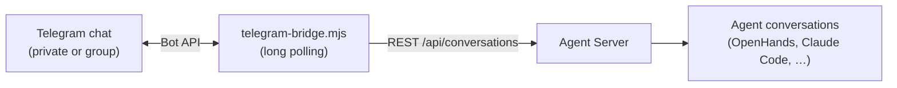

# Coordinate agents from Telegram

`scripts/telegram-bridge.mjs` connects a Telegram chat to your Agent Server, so
you can start several agents, talk to each one, approve risky actions and get
their results from Telegram instead of Slack. It is a small Node script with no
extra dependencies. It uses the same Agent Server REST API as Agent Canvas.



## Setup

1. **Create a bot.** In Telegram, talk to `@BotFather`, run `/newbot` and copy the
   token. Keep **privacy mode on** (the default). In groups the bot then only
   sees commands, `@bot` mentions and replies to its own messages.
2. **Configure an agent in Agent Canvas.** The bridge starts conversations from
   an **Agent Profile**. By default it uses the server's active profile, which
   you choose in Settings → Agent. See [Claude models and subscriptions](#claude-models-and-subscriptions).
3. **Find your chat id.** Run the bridge with only the token. With an empty
   allowlist it runs in setup mode and answers nothing but `/whoami`:

   ```bash
   TELEGRAM_BOT_TOKEN=123:abc npm run telegram-bridge
   ```

   Send `/whoami` to the bot (or in the group, `/whoami@YourBot`). Then stop it.
4. **Run it for real:**

   ```bash
   TELEGRAM_BOT_TOKEN=123:abc \
   TELEGRAM_ALLOWED_CHAT_IDS=-1001234567890 \
   OH_SESSION_API_KEY=your-session-key \
   npm run telegram-bridge
   ```

### In the desktop app

The desktop app starts the bridge on its own. You don't need a terminal, a
session key or a server URL. On first launch it creates a commented
`telegram.env` file:

| OS | Location |
| --- | --- |
| macOS | `~/Library/Application Support/OpenHands Agent Canvas/telegram.env` |
| Windows | `%APPDATA%\OpenHands Agent Canvas\telegram.env` |
| Linux | `~/.config/OpenHands Agent Canvas/telegram.env` |

1. Set `TELEGRAM_BOT_TOKEN`, then restart the app. The bot is now in setup mode.
2. Send `/whoami` to the bot. Put the id it returns in
   `TELEGRAM_ALLOWED_CHAT_IDS`, then restart the app again.

The bridge stops when you quit the app. If it crashes, it restarts on its own
after a short wait, and the rest of the app keeps running. Variables set in the
app's environment override the file.

In Docker, the same variables go in `.env` (see [DEPLOY.md](DEPLOY.md)).

### Environment variables

| Variable | Default | Meaning |
| --- | --- | --- |
| `TELEGRAM_BOT_TOKEN` | — (required) | Bot token from `@BotFather`. |
| `TELEGRAM_ALLOWED_CHAT_IDS` | empty = setup mode | Comma-separated chat ids that may drive agents. |
| `TELEGRAM_ALLOWED_USER_IDS` | empty = anyone in an allowed chat | Optionally limit control to these Telegram user ids. |
| `OH_AGENT_SERVER_URL` | `http://127.0.0.1:18000` | Agent Server base URL. |
| `OH_SESSION_API_KEY` | — | The Agent Server session key, if it has one (`SESSION_API_KEY` also works). |
| `OH_AGENT_PROFILE` | server's active profile | Agent Profile (name or id) for new agents. |
| `OH_WORKING_DIR` | `workspace/project` | Workspace directory for new conversations. |
| `TELEGRAM_BRIDGE_STATE` | `.telegram-bridge-state.json` | Where the chat → agent mapping is stored. |
| `TELEGRAM_BRIDGE_POLL_MS` | `4000` | How often agent status is checked. |
| `TELEGRAM_API_BASE` | `https://api.telegram.org` | Bot API base URL, for a local Bot API server or tests. |
| `TELEGRAM_TIMEZONE` | `TZ`, else `UTC` | Time zone for `/schedule` and `/bot` times, e.g. `America/Bogota`. |

> [!WARNING]
> Agents can run shell commands on the Agent Server machine. Anyone who can post
> in an allowed chat can tell them what to do. Use a private chat or a closed
> group, and set `TELEGRAM_ALLOWED_USER_IDS` for shared groups.

## Automatic mode (default)

Write what you need in plain language, with no command. The chat's
**@coordinador** agent gets the request and:

1. answers directly if it's a question or a small task;
2. otherwise plans the work as `@name: subtask` lines, and the bridge creates
   those sub-agents right away (no button);
3. when they all finish, the bridge sends their reports back to @coordinador,
   which integrates them and either assigns follow-ups (reusing the same
   agents) or replies with the final summary.

Distribution is capped at 3 rounds per request. Destructive or sensitive work
still needs your consent (change-safety-guard). `/auto off` switches to manual
mode, where plain text goes to the active agent; `/auto on` switches back.
Replies to an agent's message and `@name message` always go to that agent.

## Commands

| Command | What it does |
| --- | --- |
| `/new <task>` | Starts a new agent with the task and makes it the active one. |
| `/new @name <task>` | The same, with a name you can address (`@name`). |
| `/team [@name] <task>` | Starts a **lead** agent that studies the project and splits the work into up to 6 subtasks. Its plan comes with a **Repartir** (distribute) button that starts one sub-agent per subtask. |
| `/dispatch` + lines | Hands out tasks yourself, one per line: `@name task`. An existing agent with that name gets a message; a new name starts a new agent. |
| `/dir [path]` | Shows or sets the folder the next agents work in, e.g. `/dir /documents/dracma-web`. `/dir reset` goes back to the default. |
| `/agents` | Lists this chat's agents with their status. ▶️ marks the active one. |
| `/use <name or number>` | Changes the active agent. |
| `@name <message>` | Sends the message to that agent. |
| plain text | Goes to the active agent (in private chats, or when replying/mentioning in groups). |
| reply to an agent's message | Goes to the agent that wrote it. |
| `/all <message>` | Broadcasts to every agent in the chat. |
| `/status [name]`, `/result [name]` | Shows status, or the agent's last final answer. |
| `/stop [name]` | Pauses an agent. |
| `/forget <name>` | Stops tracking an agent here. The conversation stays on the server. |
| `/profiles`, `/profile <name>` | Lists Agent Profiles, or picks one for this chat's next `/new`. |

### Agents talk to agents (and humans) in the chat

The chat is shared by humans and agents. Every agent learns who else is in
the chat, and can address another agent with a line in its answer:

```
PARA @pen: alinea el logo del header de Wallet
```

The bridge posts it (`💬 @ux → @pen: …`) and delivers it to `@pen`, whose
answer can come back the same way. Humans read everything and can answer for
any agent, or talk to one with `@name <message>`. A loop guard limits each
agent to 6 messages to other agents per hour; council experts debate through
the council's rounds instead.

### Projects: one chat or topic per project

To run many projects from one bot, give each its own **scope**. A scope is a
private chat, a group, or one **topic** of a group with topics turned on.
Each scope has its own coordinator, agents, folder, project, bots,
schedules and councils, so work on one project never lands in another.

- `/project new <name> [folder]` registers a project (folder defaults to
  `/documents/<name>` and must exist). In a group with topics, the bot opens
  a topic `📁 <name>` bound to it (give the bot the **Manage topics** admin
  right); elsewhere it binds the current chat.
- `/project use <name>` binds the current chat or topic. Switching project
  retires that scope's coordinator, so the next request starts a fresh one in
  the new folder.
- `/project` shows the current project and the list; `/project rm <name>`
  removes it from the list (files stay).

Every conversation is tagged `project=<name>` in Agent Canvas, agents are told
to store and search memory as `[<name>] …`, and the memory watcher tags its
summaries with the project, so lessons from one project don't leak into
another.

Turning on topics converts a group into a supergroup with a new id. The
bridge follows the migration: the new id stays authorized and the group's
agents, projects and schedules move with it. Still, update
`TELEGRAM_ALLOWED_CHAT_IDS` with the new id (`/whoami`) so it survives a reset
of the bridge state.

### Expert commands

Each one sends @coordinador a request that names the right skill, in the
current `/dir` folder. They report first and change code only when you say
so (fixes go through feature branches and PRs).

| Command | Skill | What you get |
| --- | --- | --- |
| `/scan <type> [focus]` | `code-scans` | Ranked findings with `path:line`. Types: performance, database, coverage, dead-code, quality, cleanup, telemetry, accessibility, compliance, security, dependencies, custom. Then "arregla S1 y S3". |
| `/review <PR>` | `pr-reviewer` | Bugs, Flags and Security findings, test results and a verdict. Posting to GitHub or auto-fixing only when you ask. |
| `/wiki [notes]` | `repo-wiki` | A wiki in `docs/wiki/` (PR) with Mermaid architecture, data model and API pages, linked to the code. Steer it with `.openhands/wiki.json`. |
| `/ask <question>` | `codebase-qa` | A cited answer, read-only. |
| `/plan <goal>` | `codebase-qa` | Impact analysis, steps, open questions and a ready-to-send task prompt. |
| `/latency [focus]` | `latency-optimizer` | Fixes the slowest endpoint, page, job or query and opens one small PR with before and after numbers. |
| `/security [focus]` | `security-audit` | OWASP, authz, secrets, dependencies and config findings, read-only. |
| `/migrate <from → to>` | `migration-modernization` | A step-by-step plan for approval, then one PR per step. |
| `/insights [name]` | `session-insights` | The bridge reads that agent's events and a new agent reports where time went, an improved prompt, and saves lessons to memory. |
| `/design <task>` | `pencil-design` | Frontend with pen.dev: implements a `.pen` design in code (or designs from code) through the Pencil MCP, maps styles to your tokens, opens a draft PR. See [PENCIL.md](PENCIL.md). |
| `/pen <anything>` or "pen, …" | `pencil-design` | Talk to pen.dev in plain language. Photos ("foto de la pantalla wallet únicamente") and "lista" are answered by the bridge directly; changes ("arregla el header de wallet") go to the chat's design agent `@pen`, which edits live in the Pen app and the bridge then posts photos of the frames it changed. |
| `/ux [screen]` or "pen, revisa la ux de …" | `ux-design`, `pencil-design` | The chat's `@ux` agent reviews the screens (hierarchy, heuristics, WCAG AA, spacing, type, tokens, copy, states), ranks the findings, and optimizes a copy `· UX v2` of each screen (originals untouched). The bridge posts before/after photos. |

### Expert council: parallel work, debate and decisions

`/consejo [experts:] <topic>` runs a council of expert agents in three phases:

1. **Proposals, in parallel.** One read-only agent per expert studies the
   project on its own (memory, wiki, code) and writes a diagnosis with
   evidence and up to 4 proposals, each with an id (`ux-P1`), impact, effort,
   risk and how to measure success.
2. **Debate and vote.** When all have answered, each expert gets the others'
   proposals, argues where it disagrees (with evidence from the code), may
   merge proposals or change its mind, and ends with `VOTOS: id, id, id`. The
   bridge counts the votes (Borda: 3/2/1 points; at most one of your own).
3. **Decision.** `@moderador` weighs evidence over votes and writes the
   decision, consensus and disagreements, a decision matrix, a short ADR, and
   a plan of `@name: task` lines. It saves the decision to memory, so later
   agents don't reopen it. The plan comes with a **Repartir** (distribute) button: the
   team then works in parallel, each agent on its own worktree and draft PR,
   and the moderator integrates them into one PR.

Nothing changes in the code until you approve the plan. Experts: `producto`,
`ux`, `frontend`, `backend`, `arquitectura`, `qa`, `seguridad`,
`rendimiento`, `devops`, `growth`, `datos` (English aliases work too: `pm`,
`security`, `perf`, `marketing`, `data`…). Default panel: producto, ux,
arquitectura, qa, seguridad; at most 6. `/consejo` alone lists them and the
councils in progress. `/bot consejo` runs one every Thursday.

```
/dir /documents/dracma-web
/consejo ux, growth, producto, frontend: por qué no convierte la landing
```

### Bots and scheduled tasks

A **bot** is a scheduled request that owns one outcome. `/bots` lists the
templates; `/bot <template> [when]` turns one on for this chat and folder:

| Bot | Default | Does |
| --- | --- | --- |
| `latency` | Monday 09:00 | `/latency`: one measured speed-up PR a week |
| `scans` | Wednesday 09:00 | `/scan quality` |
| `security` | Friday 09:00 | `/security` (read-only) |
| `deps` | Monday 08:00 | `/scan dependencies` |
| `consejo` | Thursday 10:00 | An expert council proposes the week's top 3 product improvements |
| `wiki` | Sunday 20:00 | `/wiki`, updating only pages whose code changed |
| `qa` | weekdays 18:00 | Tests the day's PRs in an isolated container |

`/schedule <when> <text or /command>` schedules anything, e.g.
`/schedule laborables 08:30 /scan coverage src/` or
`/schedule cada 6h revisa si hay PRs nuevos y resúmelos`. *When* is
`diario HH:MM`, `laborables HH:MM`, a weekday (`lunes 09:00`, also English),
or `cada 30m|6h|1d` (15 minutes at least). `/schedule` lists them,
`/schedule rm <id>` removes one and `/schedule run <id>` runs it now. Times use
`TELEGRAM_TIMEZONE`. Schedules are stored in the bridge state, so they survive
restarts; a run missed while the container was down fires once when it's back.

When an agent starts working, the bridge posts "▶️ working", then a short
"⏳ still working" note every 3 minutes (`TELEGRAM_PROGRESS_MINUTES`, 0 = off)
that names only the kind of step (running a command, editing files…), never
the command text. When an agent finishes, errors (with the cause and how to
fix it), gets stuck or asks for confirmation, the bridge posts in the chat. Confirmation requests come with **Approve / Reject** buttons.
Every conversation is tagged `source=telegram`, so it also appears in Agent Canvas.

### Example: a lead that plans and distributes

```
/dir /documents/dracma-web
/team add a contact form with validation, an API endpoint and tests
```

1. `@lider` studies the project and replies with a plan, one line per sub-agent
   (`@api: …`, `@web: …`, `@tests: …`).
2. Press **🚀 Distribute**. Each sub-agent starts with its subtask, the team goal,
   and an instruction to stay inside its part.
3. Each sub-agent posts its result when it finishes. When all of them are done,
   press **🧩 Ask the lead to integrate**. The lead gets every result, checks that
   the pieces fit together, and replies with a final summary.

### Example: distributing by hand

```
/dispatch
@api add a /health endpoint with tests
@web show the API health on the dashboard
```

```
@web the endpoint is GET /health and returns {"ok": true}
/all when you are done, open a PR and paste the link here
```

## Claude models and subscriptions

There are two supported ways to use Claude:

- **Anthropic API key (Console plan).** In Settings → LLM, choose the
  `anthropic` provider and enter `ANTHROPIC_API_KEY`. The picker always offers
  the current Claude models (`claude-opus-5-5`, `claude-sonnet-5-5`,
  `claude-haiku-5-5`, `claude-fable-5-2`), even if your Agent Server's
  verified list is older. See `src/constants/anthropic-models.ts`.
- **Claude Pro / Max subscription.** Pick the **Claude Code** ACP agent
  ([ACP_AGENTS.md](ACP_AGENTS.md)). Then run `claude` once on the Agent Server
  machine and sign in. Claude Code reuses that login, and no API key is needed.
  This runs Anthropic's own Claude Code under your account. Canvas never
  reads or stores your claude.ai credentials. Usage counts against your plan's
  limits, under Anthropic's terms for Claude Code.

Both work from Telegram. Make the Agent Profile you want the active one (or pass
`OH_AGENT_PROFILE`, or use `/profile` in the chat).
