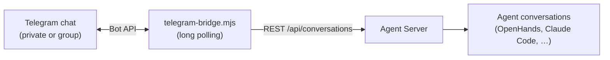

# Coordinate agents from Telegram

`scripts/telegram-bridge.mjs` connects a Telegram chat to your Agent Server, so
you can start several agents, talk to each one, approve risky actions and get
their results from Telegram instead of Slack. It is a small Node script with no
extra dependencies. It uses the same Agent Server REST API as Agent Canvas.



## Setup

1. **Create a bot.** In Telegram, talk to `@BotFather`, run `/newbot` and copy the
   token. Keep **privacy mode on** (the default). In groups the bot then only
   sees commands, `@bot` mentions and replies to its own messages.
2. **Configure an agent in Agent Canvas.** The bridge starts conversations from
   an **Agent Profile**. By default it uses the server's active profile, which
   you choose in Settings → Agent. See [Claude models and subscriptions](#claude-models-and-subscriptions).
3. **Find your chat id.** Run the bridge with only the token. With an empty
   allowlist it runs in setup mode and answers nothing but `/whoami`:

   ```bash
   TELEGRAM_BOT_TOKEN=123:abc npm run telegram-bridge
   ```

   Send `/whoami` to the bot (or in the group, `/whoami@YourBot`). Then stop it.
4. **Run it for real:**

   ```bash
   TELEGRAM_BOT_TOKEN=123:abc \
   TELEGRAM_ALLOWED_CHAT_IDS=-1001234567890 \
   OH_SESSION_API_KEY=your-session-key \
   npm run telegram-bridge
   ```

### In the desktop app

The desktop app starts the bridge on its own. You don't need a terminal, a
session key or a server URL. On first launch it creates a commented
`telegram.env` file:

| OS | Location |
| --- | --- |
| macOS | `~/Library/Application Support/OpenHands Agent Canvas/telegram.env` |
| Windows | `%APPDATA%\OpenHands Agent Canvas\telegram.env` |
| Linux | `~/.config/OpenHands Agent Canvas/telegram.env` |

1. Set `TELEGRAM_BOT_TOKEN`, then restart the app. The bot is now in setup mode.
2. Send `/whoami` to the bot. Put the id it returns in
   `TELEGRAM_ALLOWED_CHAT_IDS`, then restart the app again.

The bridge stops when you quit the app. If it crashes, it restarts on its own
after a short wait, and the rest of the app keeps running. Variables set in the
app's environment override the file.

In Docker, the same variables go in `.env` (see [DEPLOY.md](DEPLOY.md)).

### Environment variables

| Variable | Default | Meaning |
| --- | --- | --- |
| `TELEGRAM_BOT_TOKEN` | — (required) | Bot token from `@BotFather`. |
| `TELEGRAM_ALLOWED_CHAT_IDS` | empty = setup mode | Comma-separated chat ids that may drive agents. |
| `TELEGRAM_ALLOWED_USER_IDS` | empty = anyone in an allowed chat | Optionally limit control to these Telegram user ids. |
| `OH_AGENT_SERVER_URL` | `http://127.0.0.1:18000` | Agent Server base URL. |
| `OH_SESSION_API_KEY` | — | The Agent Server session key, if it has one (`SESSION_API_KEY` also works). |
| `OH_AGENT_PROFILE` | server's active profile | Agent Profile (name or id) for new agents. |
| `OH_WORKING_DIR` | `workspace/project` | Workspace directory for new conversations. |
| `TELEGRAM_BRIDGE_STATE` | `.telegram-bridge-state.json` | Where the chat → agent mapping is stored. |
| `TELEGRAM_BRIDGE_POLL_MS` | `4000` | How often agent status is checked. |
| `TELEGRAM_API_BASE` | `https://api.telegram.org` | Bot API base URL, for a local Bot API server or tests. |

> [!WARNING]
> Agents can run shell commands on the Agent Server machine. Anyone who can post
> in an allowed chat can tell them what to do. Use a private chat or a closed
> group, and set `TELEGRAM_ALLOWED_USER_IDS` for shared groups.

## Automatic mode (default)

Write what you need in plain language, with no command. The chat's
**@coordinador** agent gets the request and:

1. answers directly if it's a question or a small task;
2. otherwise plans the work as `@name: subtask` lines, and the bridge creates
   those sub-agents right away (no button);
3. when they all finish, the bridge sends their reports back to @coordinador,
   which integrates them and either assigns follow-ups (reusing the same
   agents) or replies with the final summary.

Distribution is capped at 3 rounds per request. Destructive or sensitive work
still needs your consent (change-safety-guard). `/auto off` switches to manual
mode, where plain text goes to the active agent; `/auto on` switches back.
Replies to an agent's message and `@name message` always go to that agent.

## Commands

| Command | What it does |
| --- | --- |
| `/new <task>` | Starts a new agent with the task and makes it the active one. |
| `/new @name <task>` | The same, with a name you can address (`@name`). |
| `/team [@name] <task>` | Starts a **lead** agent that studies the project and splits the work into up to 6 subtasks. Its plan comes with a **Distribute** button that starts one sub-agent per subtask. |
| `/dispatch` + lines | Hands out tasks yourself, one per line: `@name task`. An existing agent with that name gets a message; a new name starts a new agent. |
| `/dir [path]` | Shows or sets the folder the next agents work in, e.g. `/dir /documents/dracma-web`. `/dir reset` goes back to the default. |
| `/agents` | Lists this chat's agents with their status. ▶️ marks the active one. |
| `/use <name or number>` | Changes the active agent. |
| `@name <message>` | Sends the message to that agent. |
| plain text | Goes to the active agent (in private chats, or when replying/mentioning in groups). |
| reply to an agent's message | Goes to the agent that wrote it. |
| `/all <message>` | Broadcasts to every agent in the chat. |
| `/status [name]`, `/result [name]` | Shows status, or the agent's last final answer. |
| `/stop [name]` | Pauses an agent. |
| `/forget <name>` | Stops tracking an agent here. The conversation stays on the server. |
| `/profiles`, `/profile <name>` | Lists Agent Profiles, or picks one for this chat's next `/new`. |

When an agent starts working, the bridge posts "▶️ working", then a short
"⏳ still working" note every 3 minutes (`TELEGRAM_PROGRESS_MINUTES`, 0 = off)
that names only the kind of step (running a command, editing files…), never
the command text. When an agent finishes, errors (with the cause and how to
fix it), gets stuck or asks for confirmation, the bridge posts in the chat. Confirmation requests come with **Approve / Reject** buttons.
Every conversation is tagged `source=telegram`, so it also appears in Agent Canvas.

### Example: a lead that plans and distributes

```
/dir /documents/dracma-web
/team add a contact form with validation, an API endpoint and tests
```

1. `@lider` studies the project and replies with a plan, one line per sub-agent
   (`@api: …`, `@web: …`, `@tests: …`).
2. Press **🚀 Distribute**. Each sub-agent starts with its subtask, the team goal,
   and an instruction to stay inside its part.
3. Each sub-agent posts its result when it finishes. When all of them are done,
   press **🧩 Ask the lead to integrate**. The lead gets every result, checks that
   the pieces fit together, and replies with a final summary.

### Example: distributing by hand

```
/dispatch
@api add a /health endpoint with tests
@web show the API health on the dashboard
```

```
@web the endpoint is GET /health and returns {"ok": true}
/all when you are done, open a PR and paste the link here
```

## Claude models and subscriptions

There are two supported ways to use Claude:

- **Anthropic API key (Console plan).** In Settings → LLM, choose the
  `anthropic` provider and enter `ANTHROPIC_API_KEY`. The picker always offers
  the current Claude models (`claude-opus-5-5`, `claude-sonnet-5-5`,
  `claude-haiku-5-5`, `claude-fable-5-2`), even if your Agent Server's
  verified list is older. See `src/constants/anthropic-models.ts`.
- **Claude Pro / Max subscription.** Pick the **Claude Code** ACP agent
  ([ACP_AGENTS.md](ACP_AGENTS.md)). Then run `claude` once on the Agent Server
  machine and sign in. Claude Code reuses that login, and no API key is needed.
  This runs Anthropic's own Claude Code under your account. Canvas never
  reads or stores your claude.ai credentials. Usage counts against your plan's
  limits, under Anthropic's terms for Claude Code.

Both work from Telegram. Make the Agent Profile you want the active one (or pass
`OH_AGENT_PROFILE`, or use `/profile` in the chat).
