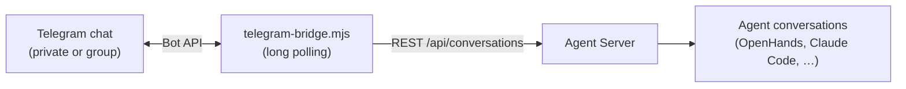

# Coordinate agents from Telegram

`scripts/telegram-bridge.mjs` connects a Telegram chat to your Agent Server, so
you can start several agents, talk to each one, approve risky actions and get
their results from Telegram instead of Slack. It is a small Node script with no
extra dependencies. It uses the same Agent Server REST API as Agent Canvas.



## Setup

1. **Create a bot.** In Telegram, talk to `@BotFather`, run `/newbot` and copy the
   token. Keep **privacy mode on** (the default). In groups the bot then only
   sees commands, `@bot` mentions and replies to its own messages.
2. **Configure an agent in Agent Canvas.** The bridge starts conversations from
   an **Agent Profile**. By default it uses the server's active profile, which
   you choose in Settings → Agent. See [Claude models and subscriptions](#claude-models-and-subscriptions).
3. **Find your chat id.** Run the bridge with only the token. With an empty
   allowlist it runs in setup mode and answers nothing but `/whoami`:

   ```bash
   TELEGRAM_BOT_TOKEN=123:abc npm run telegram-bridge
   ```

   Send `/whoami` to the bot (or in the group, `/whoami@YourBot`). Then stop it.
4. **Run it for real:**

   ```bash
   TELEGRAM_BOT_TOKEN=123:abc \
   TELEGRAM_ALLOWED_CHAT_IDS=-1001234567890 \
   OH_SESSION_API_KEY=your-session-key \
   npm run telegram-bridge
   ```

### Environment variables

| Variable | Default | Meaning |
| --- | --- | --- |
| `TELEGRAM_BOT_TOKEN` | — (required) | Bot token from `@BotFather`. |
| `TELEGRAM_ALLOWED_CHAT_IDS` | empty = setup mode | Comma-separated chat ids that may drive agents. |
| `TELEGRAM_ALLOWED_USER_IDS` | empty = anyone in an allowed chat | Optionally limit control to these Telegram user ids. |
| `OH_AGENT_SERVER_URL` | `http://127.0.0.1:18000` | Agent Server base URL. |
| `OH_SESSION_API_KEY` | — | The Agent Server session key, if it has one (`SESSION_API_KEY` also works). |
| `OH_AGENT_PROFILE` | server's active profile | Agent Profile (name or id) for new agents. |
| `OH_WORKING_DIR` | `workspace/project` | Workspace directory for new conversations. |
| `TELEGRAM_BRIDGE_STATE` | `.telegram-bridge-state.json` | Where the chat → agent mapping is stored. |
| `TELEGRAM_BRIDGE_POLL_MS` | `4000` | How often agent status is checked. |
| `TELEGRAM_API_BASE` | `https://api.telegram.org` | Bot API base URL, for a local Bot API server or tests. |

> [!WARNING]
> Agents can run shell commands on the Agent Server machine. Anyone who can post
> in an allowed chat can tell them what to do. Use a private chat or a closed
> group, and set `TELEGRAM_ALLOWED_USER_IDS` for shared groups.

## Commands

| Command | What it does |
| --- | --- |
| `/new <task>` | Starts a new agent with the task and makes it the active one. |
| `/new @name <task>` | The same, with a name you can address (`@name`). |
| `/agents` | Lists this chat's agents with their status. ▶️ marks the active one. |
| `/use <name or number>` | Changes the active agent. |
| `@name <message>` | Sends the message to that agent. |
| plain text | Goes to the active agent (in private chats, or when replying/mentioning in groups). |
| reply to an agent's message | Goes to the agent that wrote it. |
| `/all <message>` | Broadcasts to every agent in the chat. |
| `/status [name]`, `/result [name]` | Shows status, or the agent's last final answer. |
| `/stop [name]` | Pauses an agent. |
| `/forget <name>` | Stops tracking an agent here. The conversation stays on the server. |
| `/profiles`, `/profile <name>` | Lists Agent Profiles, or picks one for this chat's next `/new`. |

When an agent finishes, errors, gets stuck or asks for confirmation, the bridge
posts in the chat. Confirmation requests come with **Approve / Reject** buttons.
Every conversation is tagged `source=telegram`, so it also appears in Agent Canvas.

### Example: coordinating a small team

```
/new @api add a /health endpoint with tests
/new @web show the API health on the dashboard
@web the endpoint is GET /health and returns {"ok": true}
/all when you are done, open a PR and paste the link here
```

## Claude models and subscriptions

There are two supported ways to use Claude:

- **Anthropic API key (Console plan).** In Settings → LLM, choose the
  `anthropic` provider and enter `ANTHROPIC_API_KEY`. The picker always offers
  the current Claude models (`claude-opus-5-5`, `claude-sonnet-5-5`,
  `claude-haiku-5-5`, `claude-fable-5-2`), even if your Agent Server's
  verified list is older. See `src/constants/anthropic-models.ts`.
- **Claude Pro / Max subscription.** Pick the **Claude Code** ACP agent
  ([ACP_AGENTS.md](ACP_AGENTS.md)). Then run `claude` once on the Agent Server
  machine and sign in. Claude Code reuses that login, and no API key is needed.
  This runs Anthropic's own Claude Code under your account. Canvas never
  reads or stores your claude.ai credentials. Usage counts against your plan's
  limits, under Anthropic's terms for Claude Code.

Both work from Telegram. Make the Agent Profile you want the active one (or pass
`OH_AGENT_PROFILE`, or use `/profile` in the chat).
